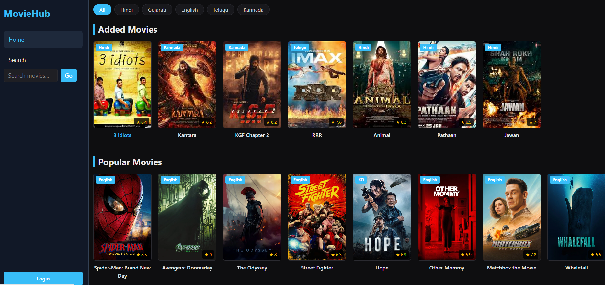

# 🎬 MovieHub

MovieHub is a movie application built using React.js. It provides a user-friendly interface to explore and display movies, with login and movie management features.

## 🚀 Features

- 🎥 Display movies using movie cards.
- 🔐 Login page and user interface.
- ➕ Add new movies.
- 🎨 Attractive and responsive user interface.
- 🧭 Sidebar navigation menu.
- 💙 Modern sky-blue color theme.
- 🔄 Redux for state management.

## 🛠️ Technologies Used

- React.js
- JavaScript
- HTML5
- CSS3
- Bootstrap
- Redux
- Vite

## 📁 Project Structure

```text
MovieHub/
├── public/
├── src/
│   ├── components/
│   │   └── Navbar.jsx
│   ├── AddMovie.jsx
│   ├── Login.jsx
│   ├── MovieCard.jsx
│   ├── actions.js
│   ├── reducers.js
│   ├── store.js
│   ├── App.jsx
│   ├── main.jsx
│   └── index.css
├── index.html
├── package.json
└── README.md
```

*Note: The structure above describes the main files used in the project; your actual folder structure may differ.*

## ⚙️ Installation and Setup

### 1. Clone the Repository

```bash
git clone <your-repository-url>
```

### 2. Open the Project Folder

```bash
cd MovieHub
```

### 3. Install Dependencies

```bash
npm install
```

### 4. Start the Development Server

```bash
npm run dev
```

### 5. Open in Browser

Open the local URL displayed in your terminal, usually:

```text
http://localhost:5173
```

## 🎨 Design

MovieHub features a modern dark-themed interface, a sidebar navigation menu, and sky-blue accent colors for links and hover effects.

## Screenshots


## 📌 Purpose

The purpose of this project is to practice React.js development, component-based architecture, state management with Redux, and front-end UI design.

## 👩‍💻 Author

**Your Name**

## 📄 License

This project is created for learning and educational purposes.
